# Easy G-Code Plot

Desktop G-code editor, analyzer, backplotter and NC/DXF exporter for FANUC turning/milling, SINUMERIK 840D milling (native and ISO-M), native SINUMERIK XZ turning with bounded ISO-T input, and HEIDENHAIN iTNC 530 Klartext milling. Controller coverage and configured kinematics are described in the [FAQ](FAQ.md).

**New in 2.7.0: native HEIDENHAIN iTNC 530 indexed 3+2 and continuous five-axis input.** Execute `PLANE SPATIAL/RESET` and rotary positioning with configured kinematics; use `M128/M129` or the supported `FUNCTION TCPM` form for continuous `L` motion on AC/BC tables. Opening `.h`/`.H` selects native Klartext milling automatically. Regression tests compare the supplied FANUC, SINUMERIK and HEIDENHAIN CAM programs across 1182 normalized cutting segments, including arc geometry and tool-axis directions. See the [iTNC input coverage and limits](FAQ.md#heidenhain-itnc-530-input). GPU milling stock removal remains three-axis.

2.7.0 also adds [native SINUMERIK XZ turning and bounded ISO-T input](FAQ.md#is-sinumerik-lathe-supported): G290/G291 switching, diameter modes and supported CYCLE93/95/97 subsets. CYCLE95 uses nominal-contour geometry and reports unverified automatic nose compensation when applicable; completion is not full controller-equivalence validation. Save As includes the HEIDENHAIN `.h/.H` filter.

**New in 2.6.0: fixed-view rotation, Tokens/Variables and native Klartext contour improvements.** Use **View → Rotate view**, the plot context menu or the View toolbar to rotate Top/Front/Left milling views around model X/Y/Z while preserving the camera center and scale. **Tokens/Variables** inspects FANUC, SINUMERIK and HEIDENHAIN execution state with diagnostic filters and search. Native `RND`/`CHF` construct rounding/chamfers before cutter compensation; a persistent notice helps select missing rotary kinematics.

[3D milling stock removal on the GPU](#3d-milling-stock-removal) follows the remaining material through a three-axis program, lets you inspect the machined surface and saves the current stock as STL. Turning stock removal remains available separately.

Checked CAM examples include programs generated in Autodesk Fusion 360 and Siemens NX 2312, plus a three-post Fusion project for FANUC, SINUMERIK 840D and HEIDENHAIN iTNC 530. Coverage follows the supported commands and configured kinematics documented below.

[](https://github.com/MaestroFusion360/easy_gcode_plot/actions/workflows/release.yml)

**Project site:** [English](https://maestrofusion360.github.io/easy_gcode_plot/) · [Русский](https://maestrofusion360.github.io/easy_gcode_plot/ru/)

<!-- markdownlint-disable MD033 -->

<p align="center">
  
</p>

<details>
  <summary><strong>More screenshots</strong></summary>

  <p align="center">
    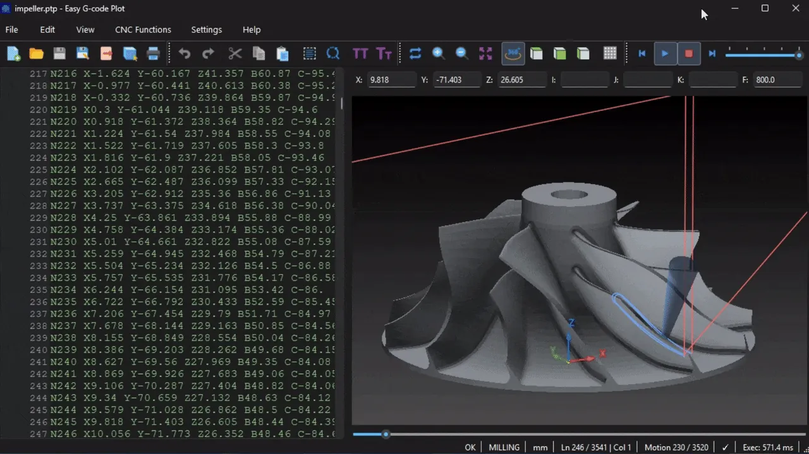
  </p>

  <p align="center">
    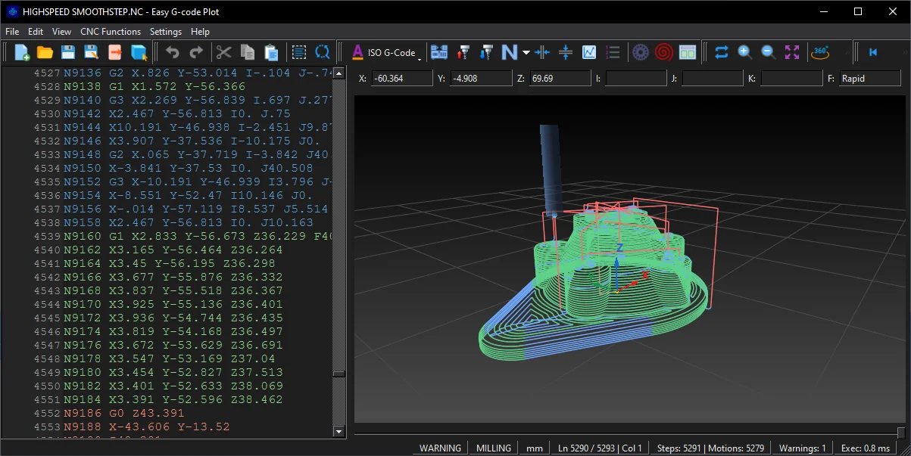
  </p>

  <p align="center">
    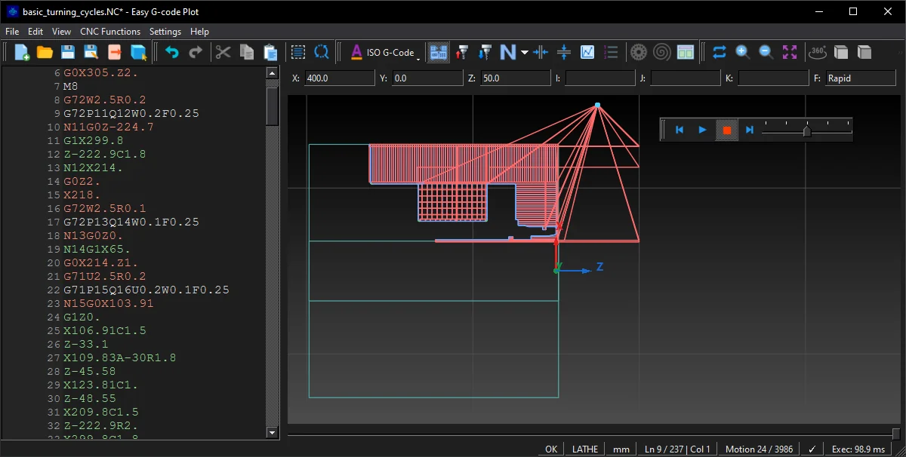
  </p>

  <p align="center">
    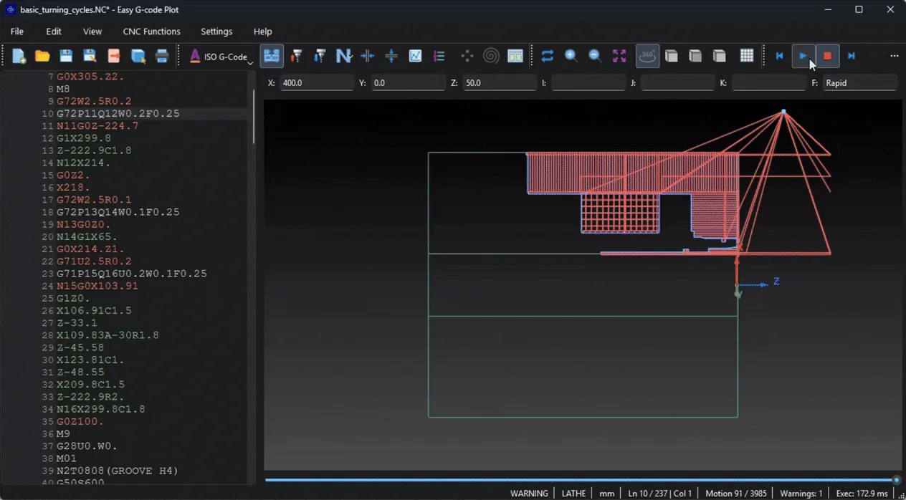
  </p>

  <p align="center">
    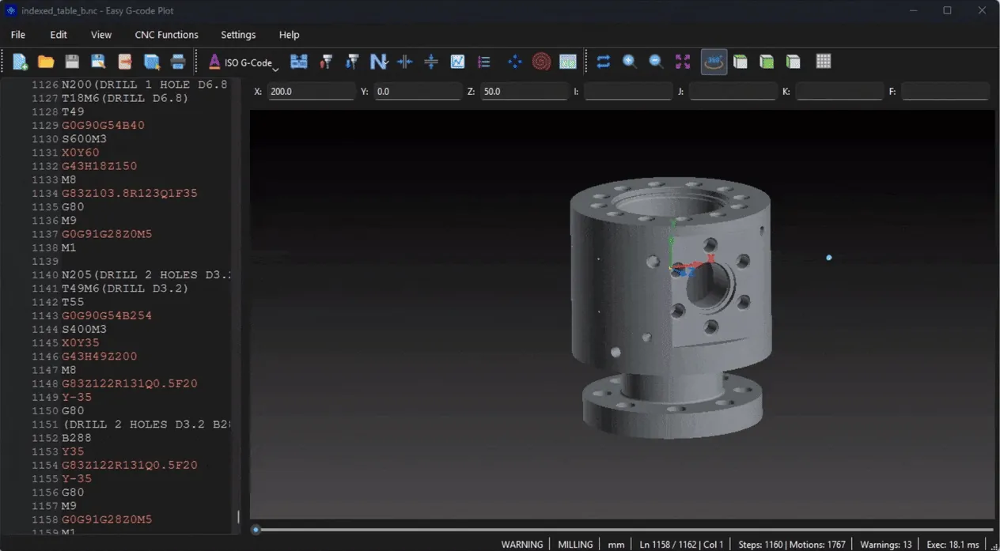
  </p>
  <p>Current dialogs and tools. Click a screenshot to view it at full size.</p>

  <table>
    <tr>
      <td align="center" width="50%">
        <a href="docs/assets-optimized/export.webp">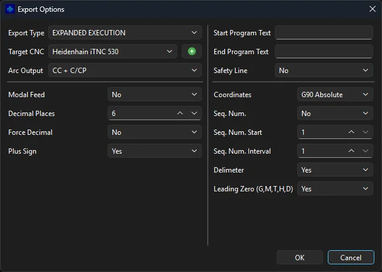</a><br>
        Export
      </td>
      <td align="center" width="50%">
        <a href="docs/assets-optimized/options.webp">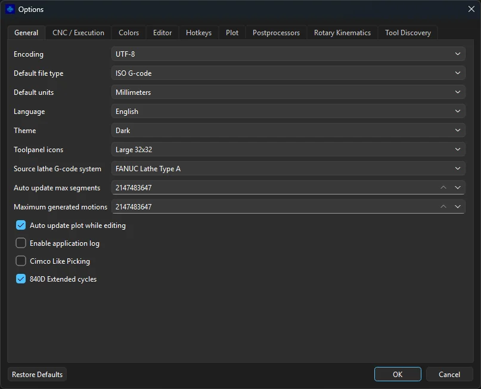</a><br>
        Options
      </td>
    </tr>
    <tr>
      <td align="center" width="50%">
        <a href="docs/assets-optimized/tool_library.webp">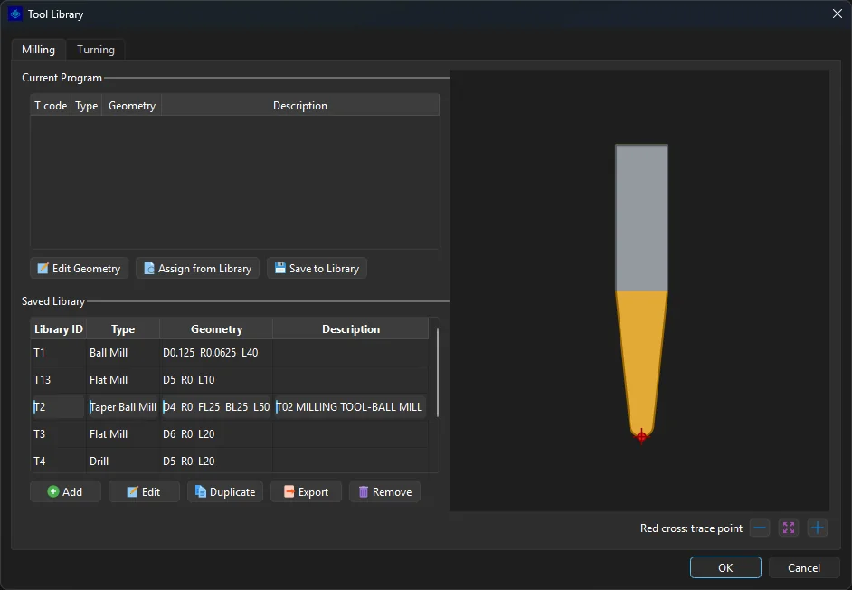</a><br>
        Tool library · milling
      </td>
      <td align="center" width="50%">
        <a href="docs/assets-optimized/tool_library2.webp">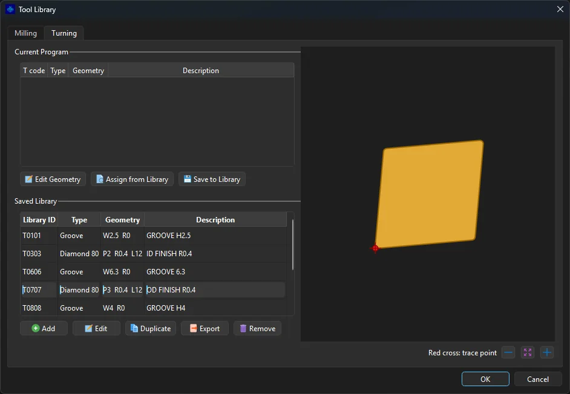</a><br>
        Tool library · turning
      </td>
    </tr>
    <tr>
      <td align="center" width="50%">
        <a href="docs/assets-optimized/hole_calculator.webp">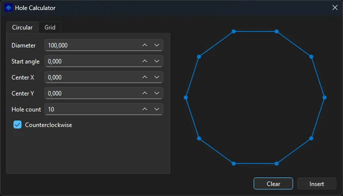</a><br>
        Hole calculator · circular
      </td>
      <td align="center" width="50%">
        <a href="docs/assets-optimized/hole_calculator2.webp">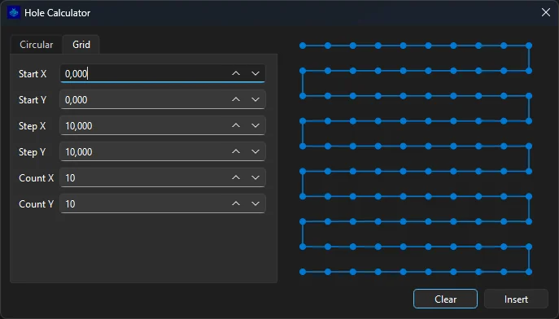</a><br>
        Hole calculator · grid
      </td>
    </tr>
    <tr>
      <td align="center" width="50%">
        <a href="docs/assets-optimized/poctet_calculator.webp">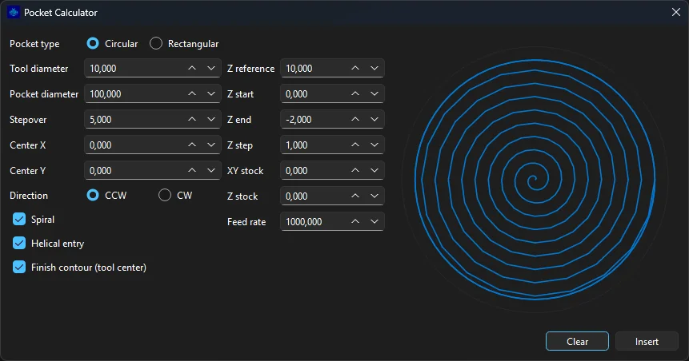</a><br>
        Pocket calculator · circular
      </td>
      <td align="center" width="50%">
        <a href="docs/assets-optimized/poctet_calculator2.webp">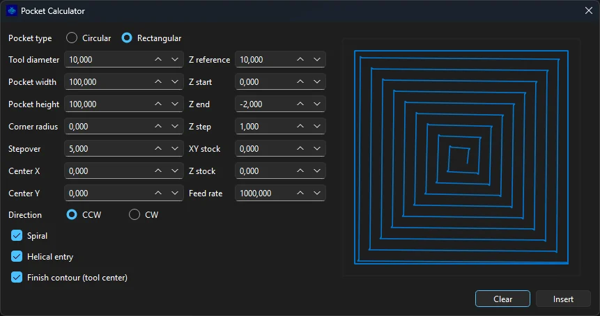</a><br>
        Pocket calculator · rectangular
      </td>
    </tr>
    <tr>
      <td align="center" width="50%">
        <a href="docs/assets-optimized/snippets.webp">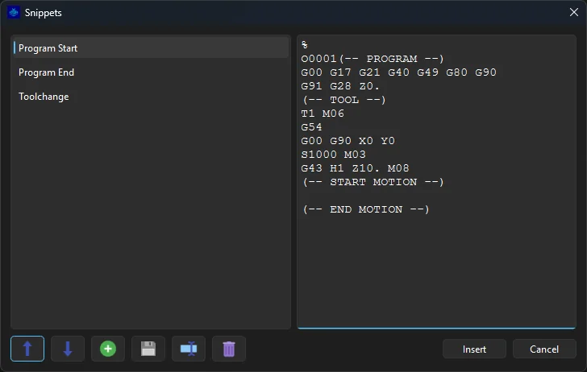</a><br>
        Snippets
      </td>
      <td align="center" width="50%">
        <a href="docs/assets-optimized/stl_objects.webp">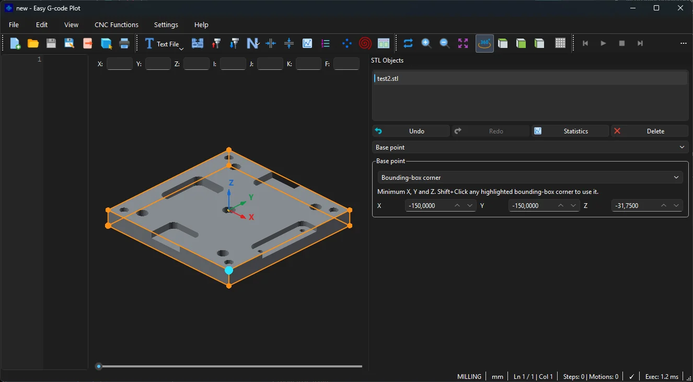</a><br>
        STL objects
      </td>
    </tr>
    <tr>
      <td align="center" width="50%">
        <a href="docs/assets-optimized/statistics.html.webp">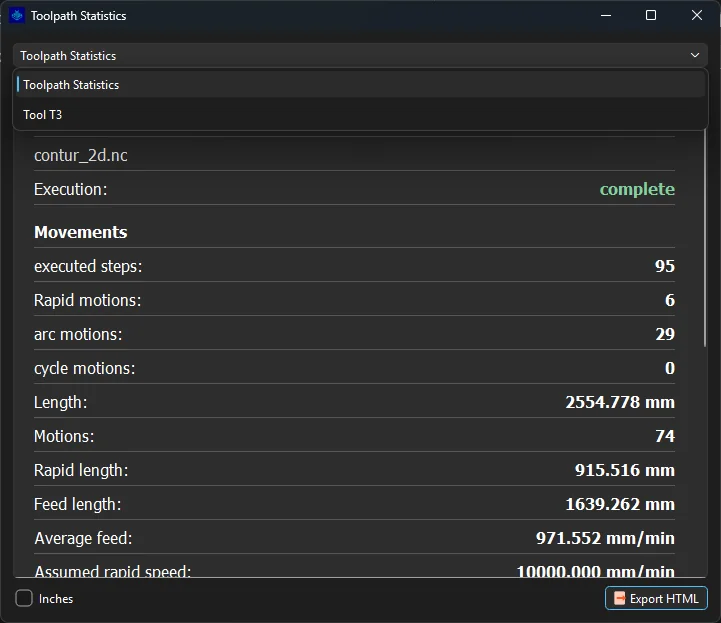</a><br>
        Toolpath statistics
      </td>
      <td align="center" width="50%">
        <a href="docs/assets-optimized/tokens_variables.webp">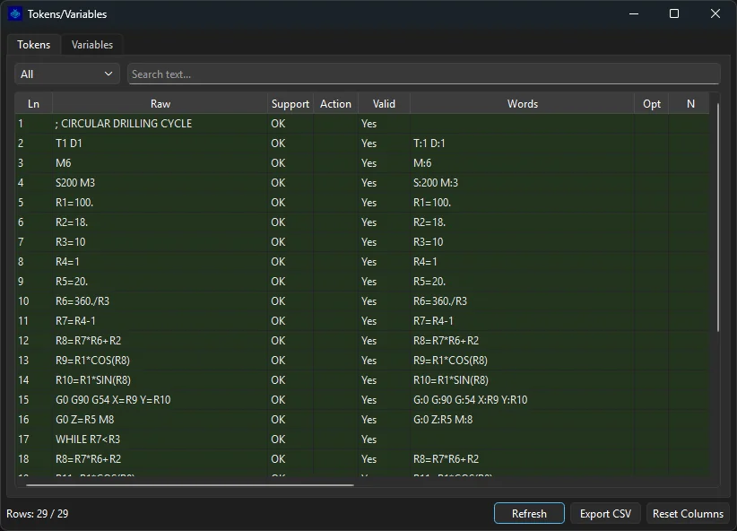</a><br>
        Tokens/Variables · FANUC # / SINUMERIK R / iTNC Q
      </td>
    </tr>
  </table>
</details>

---

## What it is

Easy G-Code Plot is a desktop workspace for editing CNC programs, inspecting calculated toolpaths, simulating stock removal and exporting NC/DXF geometry. It supports FANUC turning/milling, documented subsets of SINUMERIK 840D native/ISO-M milling and native/ISO-T turning, and native HEIDENHAIN iTNC 530 Klartext milling. Configured 3+2 and five-axis FANUC/SINUMERIK toolpaths have controller-specific limits described in the FAQ.

The GUI and CLI share one CNC execution kernel. Supported behavior, controller limits and diagnostics are described in the [FAQ](FAQ.md). The application does not model a complete physical machine.

## 3D milling stock removal

The main addition in **2.0.0** is GPU material removal for three-axis milling. Inspect the remaining stock through facing, pockets, drilling and curved finishing passes, using configured cutter geometry. Play, pause, step and rewind with the tool and displayed stock synchronized; save any machining stage as STL.

Open **Settings → Stock**, configure the box and select one of five **Accuracy** levels, then enable **Stock Removal**. Material removal and surface rendering run on the GPU; the selected detail stays fixed at every playback speed. Stock and machined-surface colors are configurable. Turning retains its separate simulator.

Requires **OpenGL 4.3**. The milling model supports vertical cutters and a box height field; rotary/TCP removal, undercuts and subtraction from imported STL solids are outside its scope. See the [milling stock guide](FAQ.md#milling-stock-removal) for setup, cutter profiles, Accuracy, GPU implementation and STL export.

---

## Quick start

### Windows release

Download the GUI executable and `easy_gcode_plot_cli.exe` from [GitHub Releases](https://github.com/MaestroFusion360/easy_gcode_plot/releases/latest).

Python and Visual Studio are not required for packaged applications.

```powershell
.\easy_gcode_plot_cli.exe --help
.\easy_gcode_plot_cli.exe analyze program.nc --lang fanuc_turn
.\easy_gcode_plot_cli.exe batch C:\Programs --lang fanuc_mill -o C:\Reports
```

### Linux release

Download the Linux x64 archive and matching `.sha256` file.

```bash
sha256sum -c Easy-G-Code-Plot-*-Linux-x64.tar.gz.sha256
tar -xzf Easy-G-Code-Plot-*-Linux-x64.tar.gz

./easy_gcode_plot
./easy_gcode_plot_cli --help
```

### Run from source

Requirements:

- Python 3.13+
- [uv](https://docs.astral.sh/uv/)
- C compiler:
  - Visual Studio Build Tools with **Desktop development with C++** on Windows
  - platform compiler and Python development headers on Linux

```bash
git clone https://github.com/MaestroFusion360/easy_gcode_plot.git
cd easy_gcode_plot

uv sync --no-dev
uv run --no-dev python main.py
```

`uv sync` builds the tracked Cython `.pyx` sources. Generated `.c`, `.pyd` and `.so` files are not stored in Git.

See the [FAQ](FAQ.md#which-native-components-exist) for native-extension requirements and source-checkout fallback behavior.

---

## First program

1. Open or drag a G-code file into the application.
2. Enable **Lathe Mode** for turning; leave it disabled for milling.
3. Check tools, WCS and machine home; select matching rotary kinematics when needed.
4. Refresh, inspect diagnostics and use playback to follow the calculated toolpath.
5. Start Stock Removal, inspect Statistics or export the program/geometry as needed.

## Documentation

| Topic | Guide |
| --- | --- |
| User reference | [English FAQ](FAQ.md) · [Русский FAQ](FAQ_RU.md), also available in **Help → FAQ** |
| Milling stock simulation | [Setup, Accuracy, GPU engine and STL](FAQ.md#milling-stock-removal) |
| Controller support | [FANUC turning](FAQ.md#fanuc-turning) · [FANUC milling](FAQ.md#fanuc-milling) · [SINUMERIK 840D](FAQ.md#sinumerik-840d-input) · [HEIDENHAIN iTNC 530](FAQ.md#heidenhain-itnc-530-input) |
| Tools and scene | [Tool Library](FAQ.md#tool-libraries-and-tool-discovery) · [Interface, editor and playback](FAQ.md#interface-editor-and-playback) |
| Export and automation | [NC/DXF export](FAQ.md#export) · [CLI](FAQ.md#cli) · [Batch analysis](FAQ.md#batch-analysis) · [Batch export](FAQ.md#batch-export) |
| Development | [Architecture and checks](FAQ.md#development-and-architecture) · [Build and release](FAQ.md#build-and-release) |
| GUI sandbox | [Regression scenario and visual demo](docs/GUI_SANDBOX.md) |
| Website | [Editing, preview and publishing](docs/PUBLISHING.md) |

---

## Community and project direction

- [Contributing](CONTRIBUTING.md): development principles, checks and pull requests.
- [Roadmap](ROADMAP.md): implemented release scope and remaining work.
- [Changelog](CHANGELOG.md): changes by version.
- [Code of Conduct](CODE_OF_CONDUCT.md): participation rules and reporting concerns.
- [Security Policy](SECURITY.md): vulnerability reporting and CNC semantics issues.
- [Report a bug or request an improvement](https://github.com/MaestroFusion360/easy_gcode_plot/issues/new/choose).

---

## License

MIT License — see [LICENSE.md](LICENSE.md).

---

<p align="center">
  
</p>
